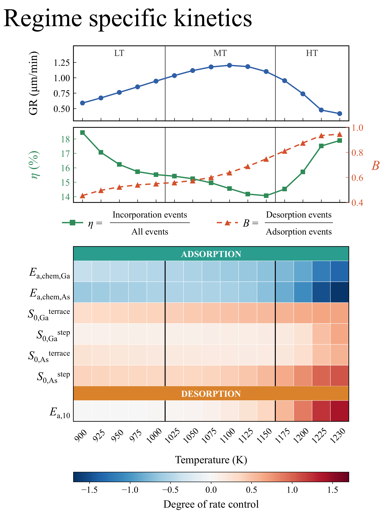

# The final fit (node 31): kinetics and roughness

## File structure

```
Final-Fit/
├── Readme.md
├── drc.csv                  DRC of all 54 parameters at node 31, per temperature (chain rule from 20 measured directions): value, SEM, SNR
├── drc_films.csv            every film of the root and of every arm (144 per arm per temperature)
├── drc_trend.csv            per parameter: its value at 900 and 1230 K, range, trend with temperature
├── kinetics.csv             per temperature: growth rate, incorporation efficiency η and B = desorption / adsorption events (node 31's 320 films)
├── roughness.csv            RMS roughness W per temperature (41) and film thickness (50–200 Å): mean, SEM, films
├── roughness_films.csv      every film's W at every 10 Å mark
├── Figures/                 the figures shown below
│   ├── kinetics.png
│   └── roughness.png
└── Reproduction/            the DRC and the roughness runs
    ├── DRC/                     add_one_sided.py, config.toml, drc.json, root_node31.json, run_drc.sh
    └── Roughness/               analyze_roughness.py, best_params_node31.json, roughness_study.py, roughness_study_lin_temperatures.py, run_rough.sh
```

Growth rate, η and B, and the DRC of every parameter that controls growth somewhere (|DRC| ≥ 0.1), against temperature at the final fit.




