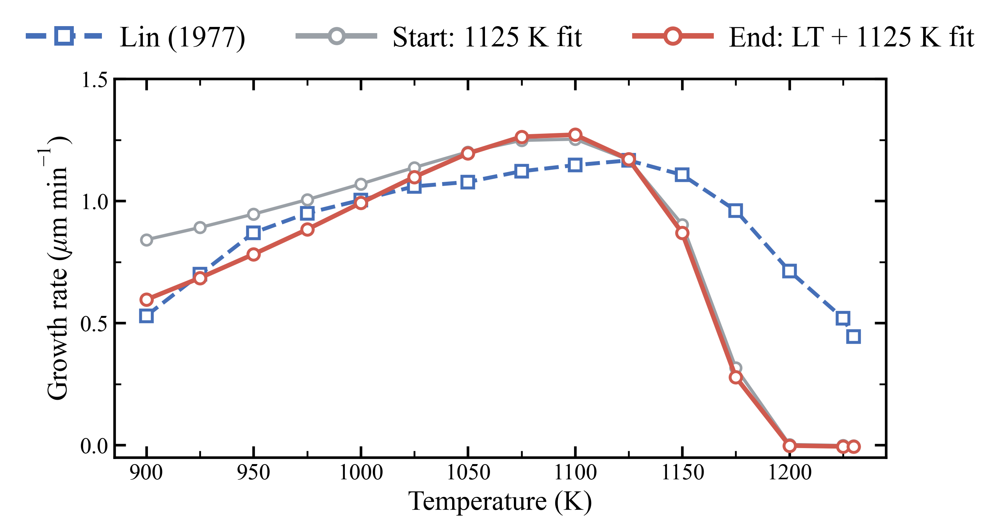

# LT + 1125 K

## File structure

```
LT+1125K/
├── Results/                   Result files of the stage
│   ├── gr_vs_T.csv
│   ├── gr_vs_T_films.csv
│   ├── gr_vs_T.png
│   ├── parameters_start.json  Rate catalog before LT+1125K
│   ├── drc.csv                Degree of rate control for rate catalog
│   ├── drc_films.csv          KMC simulations for DRC study
│   ├── drc.png
│   ├── mcts_nodes.csv         MCTS search for rate parameters
│   ├── mcts_films.csv         KMC simulations during MCTS search
│   ├── mcts_status.png
│   ├── best_gr_vs_T.png
│   └── parameters_end.json    Rate catalog after LT+1125K
└── Reproduction/              Reproduction of LT+1125K stage
    ├── GR_vs_T_start/         config.toml, fitted_1125K_phase2.json
    ├── DRC/                   config.toml, drc.json, root_fit_1125K.json
    ├── MCTS/                  config.toml, drc_table.csv, root_fit_1125K.json
    └── GR_vs_T_end/           config.toml, fit_LT1125K.json
```

Growth rate against temperature: Lin (1977); the 1125 K fit, where this stage starts; the LT + 1125 K fit (node 35), where it ends.


