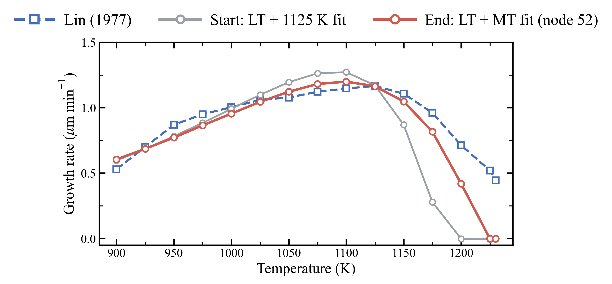

# LT + MT

## File structure

```
LT+MT/
├── Results/                       Result files of the stage
│   ├── gr_vs_T.csv
│   ├── gr_vs_T_films.csv
│   ├── gr_vs_T.png
│   ├── parameters_start.json      Rate catalog before LT+MT
│   ├── drc.csv                    Degree of rate control for rate catalog
│   ├── drc_films.csv              KMC simulations for DRC study
│   ├── drc.png
│   ├── check_900K_drc.csv         Degree of rate control at MCTS node 34
│   ├── check_900K_drc_films.csv   KMC simulations for the 900 K check
│   ├── check_900K.png
│   ├── mcts_nodes.csv             MCTS search for rate parameters
│   ├── mcts_films.csv             KMC simulations during MCTS search
│   ├── mcts.png
│   ├── best_node_parameters.json  Rate catalog of the best MCTS node
│   └── parameters_end.json        Rate catalog after LT+MT
└── Reproduction/                  Reproduction of LT+MT stage
    ├── GR_vs_T_start/             config.toml, fit_LT1125K.json
    ├── DRC/                       config.toml, drc.json, root_fit_LT1125K.json
    ├── MCTS/                      config.toml, drc_table.csv, root_fit_LT1125K.json
    ├── Check_900K/                config.toml, drc.json, node34_history.txt, root_node34.json
    └── GR_vs_T_end/               config.toml, root_fit_LTMT.json
```

Growth rate against temperature: Lin (1977); the LT + 1125 K fit, where this stage starts; the LT + MT fit (node 52), where it ends (no film grows at 1225 and 1230 K: the rate over what grew is shown).


