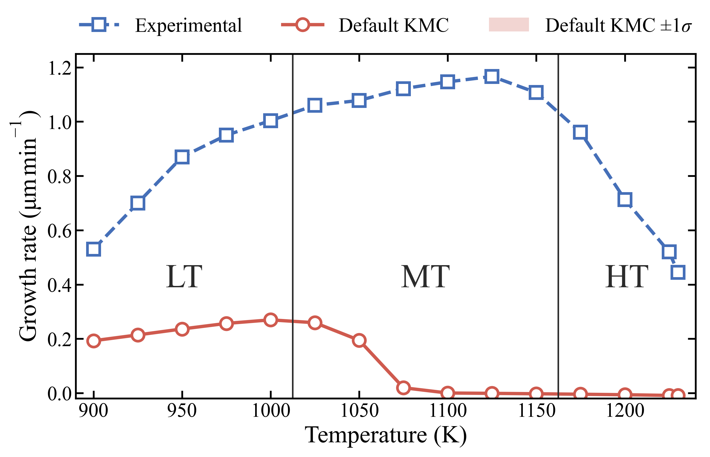
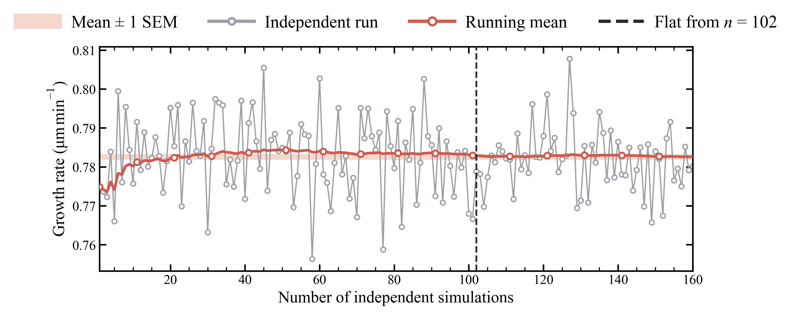

# Progressive Optimization

Optimization of  kinetic rate parameters in the KMC model by MCTS is precisely what leads to agreement of the growth rate (GR) data of experiments and KMC. 

### Rate Equations

The KMC model uses two rate laws. (1) Adsorption is driven by the a Hertz Knudsen formalism and other event, i.e., (2) Desorption, (3) Surface Incorporation and (4) Surface Decomposition, follows an Arrhenius law:

<!-- Adsorption: impingement flux x site area x sticking probability -->
$$R_{ADS} = \left( \frac{P_{(j)}}{\sqrt{2\pi M_{(j)} k_B T}} \right) \cdot A_{\text{site}} \cdot S_{0(j,s)} \cdot \exp\left( -\frac{E_{a,\text{chem}(j)}}{T} \right)$$

<!-- Modified Arrhenius: desorption, incorporation, decomposition -->
$$R_{DES} , R_{S-INCORP} , R_{S-DECOMP} = A_i \cdot T^{\beta_i} \cdot \exp\left( -\frac{E_{ai}}{T} \right)$$

> **Convention:** every activation energy is expressed in temperature units
> ($E_a \equiv E_a/k_B$, in kelvin), so each Boltzmann factor reads $\exp(-E_a/T)$.

Every reaction, its events and its parameters are listed on the [reactions page](https://hrishiharsora.github.io/MCTS-KMC/#/reactions) of the results website.

### Symbol Definitions

| Symbol | Meaning |
|---|---|
| $P_{(j)}$ | Partial pressure of species $j$, held at the experiment's inlet pressures: 608 Pa (AsH3, for AsH) and 65.86 Pa (TMGa, for MMGa) |
| $M_{(j)}$ | Molecular mass of species $j$: 75.93 u (AsH), 84.76 u (MMGa) |
| $k_B$ | Boltzmann constant |
| $T$ | Substrate temperature |
| $A_{\text{site}}$ | Area of one surface adsorption site, $1.6 \times 10^{-19}$ m$^2$ (converts impingement flux to a per-site rate) |
| $s$ | Adsorption site type: terrace or step |
| $S_{0(j,s)}$ | Sticking coefficient of species $j$ at a site of type $s$, with $S_{0(j,\text{terrace})} \leq S_{0(j,\text{step})}$ |
| $E_{a,\mathrm{chem}(j)}$ | Chemisorption activation energy of species $j$ (in kelvin) |
| $A_i$ | Pre-exponential factor of reaction $i$ |
| $\beta_i$ | Temperature exponent of reaction $i$ |
| $E_{ai}$ | Activation energy of reaction $i$ (in kelvin, $E_a/k_B$) |

> **Note:** Here, $j \in \{\text{MMGa}, \text{AsH}\}$, denoting species which actually reach the surface after the precursors TMGa and AsH3 react and decompose in the vapor phase. Since $P_{(j)}$ is fixed, only the product $P_{(j)} \cdot S_{0(j,s)}$ enters $R_{ADS}$, and the sticking coefficients carry that freedom in the fit.

Altogether there are 54 parameters which govern the rates of the 20 surface reactions that the KMC model uses to deposit GaAs films. Attempting to optimize **all** parameters at once across all 15 temperature points is a futile approach because different reactions govern the growth behavior in different temperature regimes. Different parameters act as dominant **knobs** in these different temperature regimes. Hence, the task of optimization is progressive and the curve is fitted one temperature regime at a time which are defined as follows:

The experimental GR peaks at 1125K whilst the KMC model, with the default parameter set, predicts ~0 growth at all temperatures. Hence, GR at 1125 K is fitted first. Next, the fit is extended outward one regime at a time. The low-temperature arm (LT: 900, 925, 950, 975, 1000 K) is added next, giving a six-point target; then the mid-range (MT: 1025, 1050, 1075, 1100, 1125, 1150 K) for eleven points; and finally the high-temperature tail (HT: 1175, 1200, 1225, 1230 K), which closes the full fifteen-point curve.

### Considerations During Optimization 

#### Noise in KMC
KMC is stochastic ,i.e., two films grown with the same parameters at the same temperature give slightly different growth rates. The growth rate at a temperature is therefore the mean over an ensemble of independent films (different random seeds). An example is shown below:

The same check for every temperature at every stage, the running mean of each ensemble against its ±1 SEM band, can be found [here](https://hrishiharsora.github.io/MCTS-KMC-results/).
