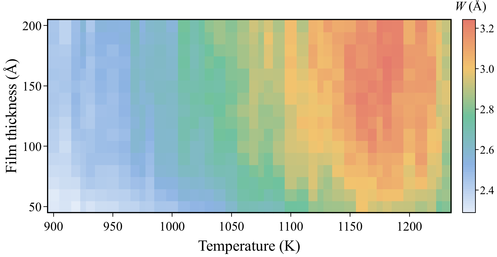

# Roughness Correlation Study

Surface roughness of the growth front at the final fit (node 31), against temperature and film thickness. Nothing here was fitted: the films are grown with the parameter set the optimization ended at, and the roughness is read from them as they grow.

## File structure

```
Roughness Correlation Study/
├── Readme.md
├── roughness.csv            RMS roughness W per temperature (41) and film thickness (50–200 Å, every 10 Å):
│                            mean, SEM, CV, films read, and the flat-region count n_flat
├── Figures/
│   └── roughness_map.png    the figure below
├── Snapshots/               one XYZ trajectory per temperature, T<T>_r000.xyz.gz: film 0 at that temperature,
│                            16 frames (50 → 200 Å), every occupied site with the engine's species name;
│                            gzip-compressed, OVITO opens them as they are
└── Reproduction/            the scripts, parameter set and commands that reproduce roughness.csv and Snapshots/
```




RMS roughness $W$ of the growth front at the final fit over temperature and film thickness. 

The map can be explored cell by cell, with $W$ against thickness at any temperature [here](https://hrishiharsora.github.io/MCTS-KMC/#/roughness).
